<div dir="rtl">

# عروسی جن‌ها | فصل ۲ | قسمت ۱

تصاویر مرجع و همه‌ی شات‌ها با داستان، راوی، دیالوگ و پرامپت ویدیو (بدون موسیقی). هر بلوک پرامپت دکمه‌ی کپی داره.

</div>

## تصاویر مرجع

<table><tr><td align="center">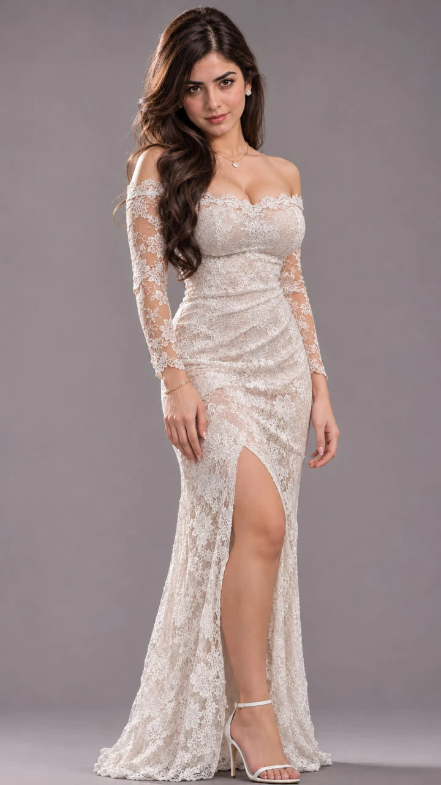<br>نفیسه</td><td align="center">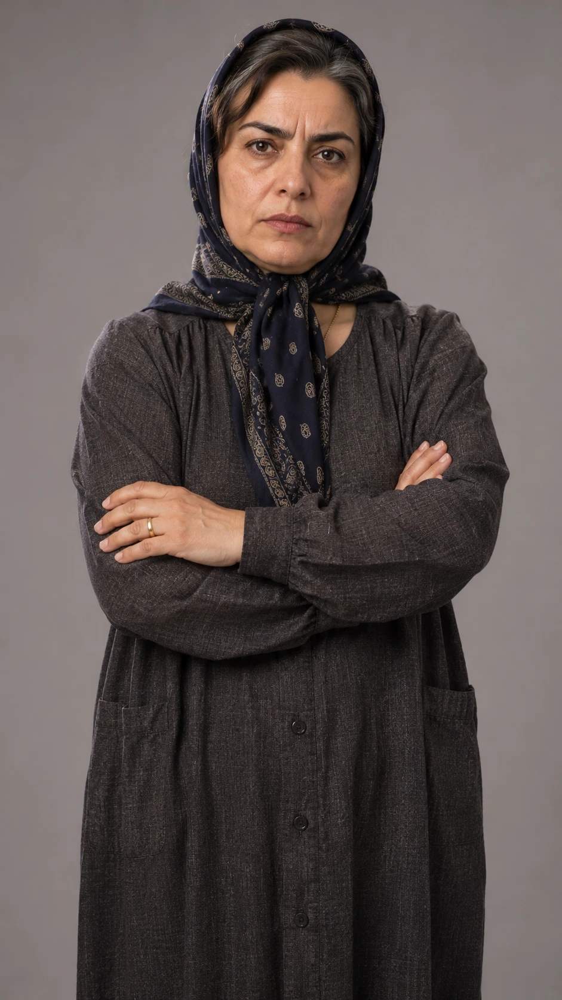<br>مادر نفیسه</td><td align="center">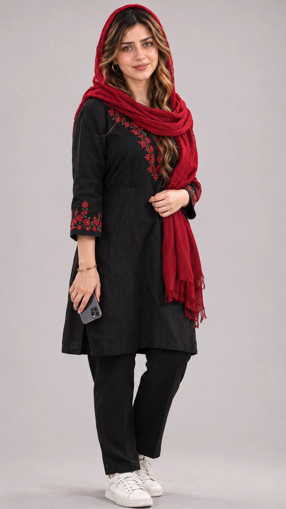<br>سارا</td><td align="center"><br>داماد</td><td align="center">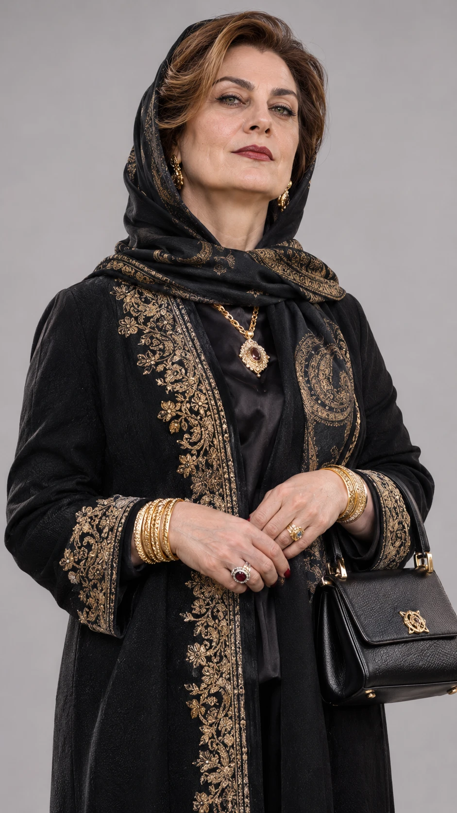<br>مادر داماد</td></tr><tr><td align="center"><br>پدر داماد</td><td align="center">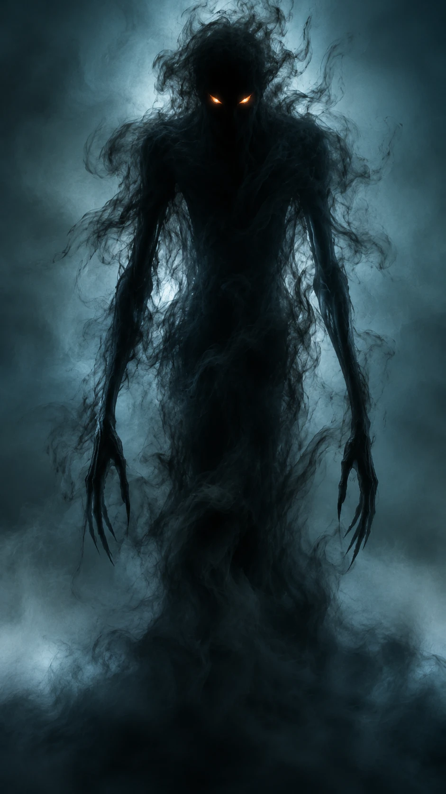<br>سیاهی</td><td align="center">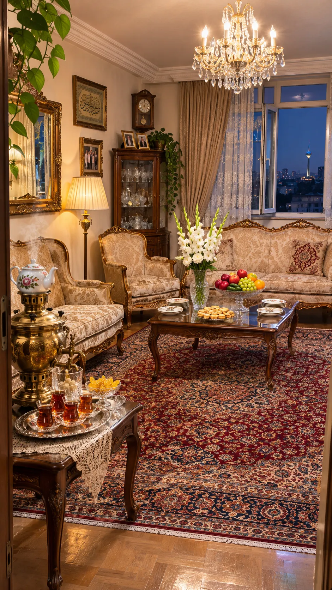<br>پذیرایی</td><td align="center">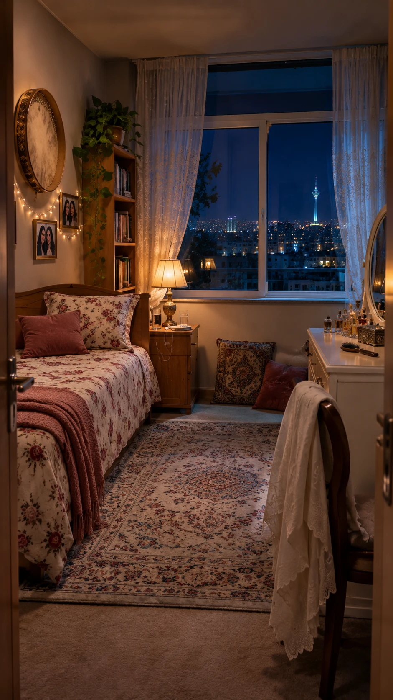<br>اتاق نفیسه</td></tr></table>


---

<div dir="rtl">

## سکانس ۱: قلاب و یادآوری

</div>

<div dir="rtl">

### شات ۱الف: نفیسه با سینی چای از آشپزخونه میاد

⏱ حدود ۲ ثانیه (توی ادیت کوتاه می‌شه)

شب خواستگاری. نفیسه با پیراهن توری سفید و تور سبک روی سر، سینی چای رو از آشپزخونه به پذیرایی میاره. هنوز همه‌چی آروم و گرمه.


🔊 همهمه‌ی آروم مهمونی، قل‌قل سماور، جرینگ ملایم استکان‌ها، صدای قدم‌ها. بدون موسیقی.

</div>

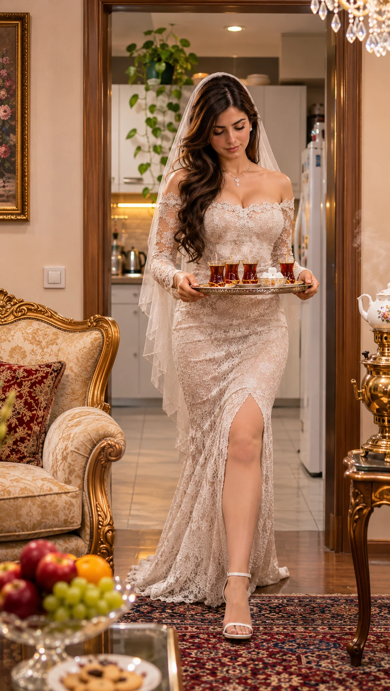

**پرامپت ویدیو (Gemini):**

```
Animate this exact image. Keep Nafiseh's face, hair, white lace dress, sheer veil, the tray and the whole room exactly the same. Vertical 9:16, 4 seconds, realistic live-action footage, cinematic, natural motion, no morphing.

Action: Nafiseh walks slowly and gracefully from the kitchen doorway into the living room toward the camera, carefully carrying the silver tray of tea glasses with both hands. Her eyes stay lowered on the tray, a shy small smile on her lips. Her sheer white veil and long wavy dark-brown hair sway softly with each step, the lace dress moves naturally around her legs. The tea in the glasses trembles slightly. Thin steam rises from the tea glasses and from the brass samovar on the right.

Camera: smooth slow dolly backward, keeping her centered, very subtle handheld feel, shallow depth of field, the fruit bowl in the foreground stays softly out of focus.

Lighting: warm tungsten evening light, the crystal chandelier sparkles gently.

Sound: diegetic ambient sound only — a soft indistinct murmur of guests chatting in Persian off-screen, the quiet bubbling of the samovar, faint clinking of tea glasses on the silver tray, her soft footsteps on the wooden floor and then on the carpet.
No dialogue. NO background music, no score, no soundtrack, no singing.
```

<div dir="rtl">

### شات ۱ب: تعارف چای به مادر داماد

⏱ حدود ۲ ثانیه

نفیسه خم شده و چای رو به مادر داماد تعارف می‌کنه. مادر داماد با لبخند دست دراز می‌کنه. این آخرین لحظه‌ی آرامشه؛ شات بعد دست نامرئی مچ نفیسه رو می‌گیره.


🔊 همهمه‌ی آروم مهمونی، قل‌قل سماور، جرینگ النگوهای طلا، صدای استکان روی نعلبکی. بدون موسیقی.

</div>

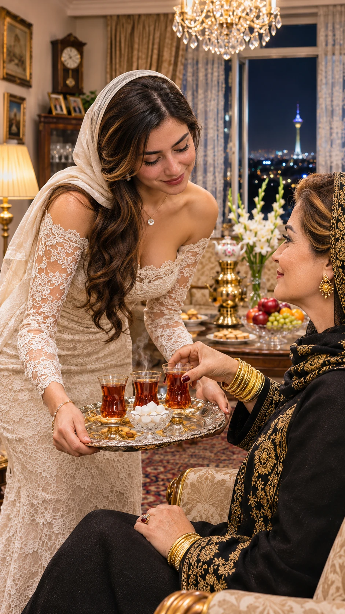

**پرامپت ویدیو (Gemini):**

```
Animate this exact image. Keep Nafiseh's face, hair, white lace dress and veil, the groom's mother's face, black gold-embroidered outfit and gold jewelry, and the whole room exactly the same. Vertical 9:16, 4 seconds, realistic live-action footage, cinematic, natural motion, no morphing.

Action: Nafiseh stays slightly bent forward, holding the silver tray steady with both hands, eyes lowered, a shy polite smile, she takes a small nervous breath. The groom's mother slowly reaches out with her gold-bangled hand and picks up one tea glass by its saucer; her stacked gold bangles slide and clink softly. She gives Nafiseh a polite but cold smile and her eyes briefly look her up and down. Thin steam rises from the tea glasses. In the background the samovar steams gently and the chandelier sparkles.

Camera: very slow push-in toward the tray and the two women's hands, subtle handheld feel, shallow depth of field.

Lighting: warm tungsten evening light, cool blue night light from the window with the Milad Tower in the background.

Sound: diegetic ambient sound only — a soft indistinct murmur of guests chatting in Persian off-screen, the quiet bubbling of the samovar, the soft clink of gold bangles, a small clink of the tea glass on its saucer.
No dialogue. NO background music, no score, no soundtrack, no singing.
```

<div dir="rtl">

### شات ۲: دست سیاه مچ نفیسه رو می‌گیره و سینی کج می‌شه

⏱ حدود ۱ ثانیه

یه دست دودی و سیاه (از جنس «سیاهی») از ناکجا مچ نفیسه رو می‌گیره و سینی رو به سمت مادر داماد کج می‌کنه. چای از استکان‌ها بیرون می‌پره و چشم‌های نفیسه از وحشت گشاد می‌شه. فقط نفیسه این دست رو حس می‌کنه.


🔊 نفس بریده‌ی نفیسه (هین)، لرزیدن و جرینگ استکان‌ها روی سینی، شُرّه‌ی چای، یه هوهوی آروم و بم دود. بدون موسیقی.

</div>

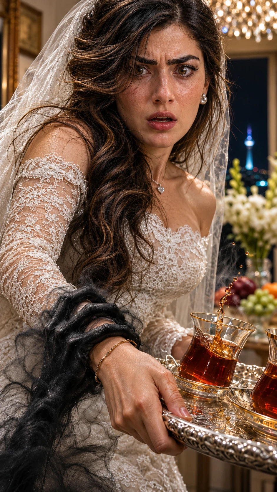

**پرامپت ویدیو (Gemini):**

```
Animate this exact image. Keep Nafiseh's face, hair, white lace dress, veil, the dark smoky hand, the silver tray, the tea glasses and the room exactly the same. Vertical 9:16, 4 seconds, realistic live-action footage, cinematic, natural physics, no morphing.

Action: The hand made of dark black smoke tightens its long thin fingers around Nafiseh's wrist and sharply pulls and twists it down to the right. The silver tray tilts steeply; the tulip-shaped tea glasses slide and rattle on their saucers, and hot amber tea splashes out of the glasses in arcs toward the right side of the frame, droplets flying, steam swirling. Dark wisps of smoke curl and drift off the black fingers and around her arm. Nafiseh gasps sharply, her eyes widen even more in shock, she tries to pull her arm back but can't; her hair and veil sway with the jolt.

Camera: starts close and steady, then a quick small jolt / shake as the tray tilts, very short slow-motion feel on the splashing tea, shallow depth of field.

Lighting: warm tungsten living-room light, the chandelier and the Milad Tower blurred in the background; the black smoke absorbs the light around her wrist.

Style: mysterious supernatural thriller, realistic.

Sound: diegetic sound only — Nafiseh's sharp frightened gasp, the rattling and clinking of the tea glasses sliding on the metal tray, the splash of tea, a low soft airy whoosh of the moving smoke, faint guest murmur in the background.
No dialogue. NO background music, no score, no soundtrack, no singing.
```

<div dir="rtl">

### شات ۳: چای جوش روی مادر داماد، جیغ و شکستن استکان‌ها

⏱ حدود ۲ ثانیه، بعد سکوت مطلق و صفحه‌ی سیاه

سینی کامل کج می‌شه و چای جوش روی دست و دامن مادر داماد می‌ریزه. مادر داماد جیغ می‌کشه، استکان‌ها روی میز شیشه‌ای خُرد می‌شن و نفیسه با وحشت دست‌هاش رو جلوی دهنش می‌گیره. بلافاصله بعدش همه‌چی قطع می‌شه: سکوت مطلق و صفحه‌ی سیاه.


**مادر داماد:** «(جیغ بلند از درد، بدون کلمه)»


🔊 شکستن شیشه و استکان، شُرّه‌ی چای، جیغ بلند مادر داماد. در پایان شات: همه‌ی صداها یک‌دفعه قطع می‌شه و سکوت مطلق. بدون موسیقی.

</div>

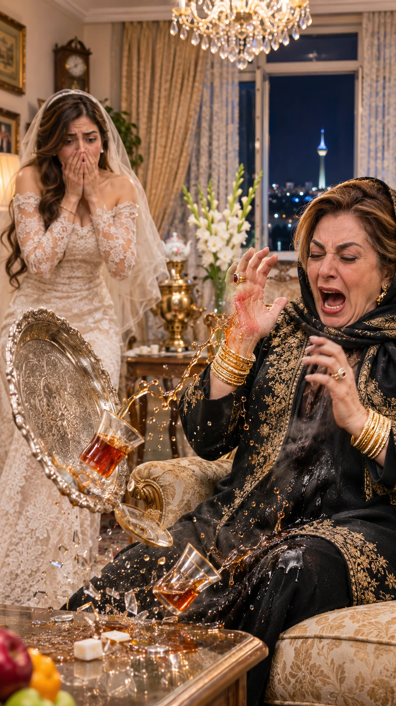

**پرامپت ویدیو (Gemini):**

```
Animate this exact image. Keep the groom's mother's face and black gold-embroidered outfit, Nafiseh's face, white lace dress and veil, the silver tray, the glass coffee table and the whole room exactly the same. Vertical 9:16, 4 seconds, realistic live-action footage, cinematic, natural physics, no morphing.

Action: Time resumes from the frozen moment. The silver tray finishes tipping and slides out of frame as the tea glasses fall. Hot amber tea splashes onto the groom's mother's hand and lap, steam rises from her wet black manteau. She throws her head back and screams in pain and shock, shaking her scalded hand, gold bangles jangling. One tea glass hits the edge of the glass coffee table and shatters, glass shards and sugar cubes scatter across the table and bounce onto the carpet. In the background Nafiseh stands frozen with both hands over her mouth, her veil slipping down her hair, her eyes full of horror. Dark wisps of smoke very faintly fade out at the left edge of the frame.

Camera: handheld, a sharp small shake at the moment of impact, quick push-in toward the groom's mother's face, then a slow push toward Nafiseh's frozen face. Shallow depth of field.

Lighting: warm tungsten living-room light, specular highlights on flying tea and glass. In the last half second the image cuts to pure black.

Style: sudden, chaotic, realistic mysterious thriller.

Sound: diegetic sound only — the loud crash of glass breaking, splashing tea, a loud sharp scream of pain from the groom's mother (no words), gasps. At the very end every sound cuts out instantly into total silence while the screen goes black.
NO background music, no score, no soundtrack, no singing.
```

<div dir="rtl">

### شات ۳ب (جدید): واکنش همه، تعجب و عصبانیت

⏱ حدود ۲ ثانیه، بلافاصله قبل از صفحه‌ی سیاه

یک ثانیه بعد از فاجعه. مادر داماد دست سوخته‌ش رو گرفته و با خشم به نفیسه خیره شده، پدر داماد با اخم سنگین پشتشه، داماد مات و نگرانه، مادر نفیسه دو دست روی سرش از شرم و ناامیدی، و نفیسه با دست روی دهن و اشک، خشکش زده.


**مادر داماد:** «آخ… دستم! دستم سوخت!»


**مادر نفیسه:** «(دو دست روی سر) وای خدا… آبرومون رفت!»


**داماد:** «مامان! حالت خوبه؟»


**پدر داماد:** «(ساکت، فقط نگاه سرد و خشمگین)»


🔊 صدای هیاهو و داد، نفس‌های تند، ریختن آخرین قطره‌های چای و تق‌تق شیشه‌ریزه‌ها. بعدش همه‌چی قطع می‌شه. بدون موسیقی.

</div>

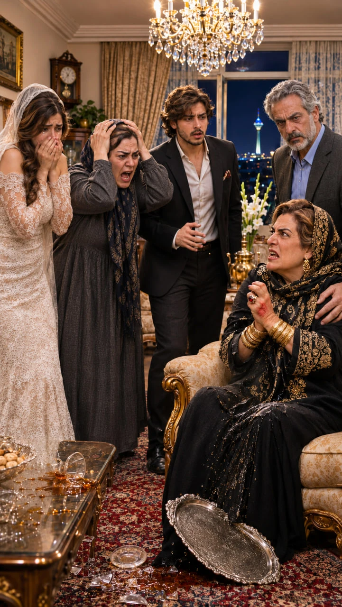

**پرامپت ویدیو (Gemini):**

```
Animate this exact image. Keep all five people's faces, clothes and positions exactly the same: Nafiseh at the far left in the white lace dress and veil, Nafiseh's mother in the grey dress and navy headscarf with both hands pressed on her head, the groom in the dark suit, the groom's father in the grey suit, and the groom's mother seated on the sofa in the tea-soaked black embroidered manteau; the same room, broken glass, spilled tea and tipped silver tray. Vertical 9:16, 4 seconds, realistic live-action footage, cinematic, natural motion, no morphing.

Action: All five react at once in a tense, chaotic moment. The groom's mother, clutching her scalded red hand, glares furiously at Nafiseh and cries out in Persian. Nafiseh's mother, both hands on her head, shakes her head in despair and shouts in Persian. The groom steps half a step toward his mother, worried and shocked, and asks in Persian. The groom's father stands behind his wife with one hand on her shoulder, jaw clenched, silent, a cold furious stare at Nafiseh. Nafiseh stands frozen with both hands over her mouth, tears rolling down her cheeks, her veil slipping slightly. A last drop of tea drips from the coffee table, tiny glass shards settle on the carpet.

Dialogue (spoken in natural Persian/Farsi with a Tehran accent, short and overlapping, emotional):
- Groom's mother (sharp, pained, angry middle-aged woman's voice): «آخ… دستم! دستم سوخت!»
- Nafiseh's mother (cracking, desperate, middle-aged woman's voice): «وای خدا… آبرومون رفت!»
- Groom (young, warm, worried male voice): «مامان! حالت خوبه؟»
- The groom's father stays completely silent.

Camera: slow handheld push-in from the wide shot toward the group, a subtle shake, shallow depth of field, all faces stay readable.

Lighting: warm tungsten living-room light, harsh dramatic shadows on the angry faces.

Sound: diegetic only — the dialogue above, quick breaths, sobbing, small clinks of settling glass shards. At the very end all sound drops out.
NO background music, no score, no soundtrack, no singing.
```

<div dir="rtl">

### شات ۴: سیاهی پشت پنجره می‌گه «تو زن منی»

⏱ حدود ۴ ثانیه

شب. نفیسه شکسته و گریان سرش رو روی میز گذاشته. «سیاهی» پشت شیشه‌ی پنجره ایستاده، آروم نزدیک شیشه میاد و با صدای بم و سرد حرف می‌زنه. نفیسه صدا رو می‌شنوه ولی سرش رو بلند نمی‌کنه.
در ادیت: راوی توی شات ۵ شروع می‌شه، نه اینجا.


**سیاهی:** «تو زن منی… هیچ‌کس حق نداره تو رو بگیره.»


🔊 صدای بم و سرد و پژواک‌دار «سیاهی» از پشت شیشه، هق‌هق خیلی آروم نفیسه، هوهوی بسیار کم باد. بدون موسیقی.

</div>

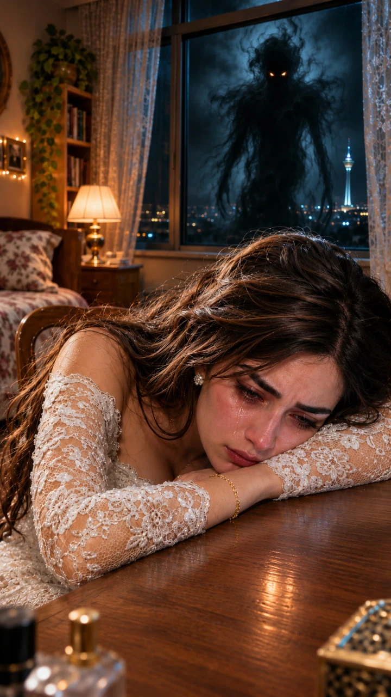

**پرامپت ویدیو (Gemini):**

```
Animate this exact image. Keep Nafiseh's face, tears, hair, white lace dress, the wooden desk, the room, and the huge dark smoky figure behind the window exactly the same. Vertical 9:16, 4 seconds, realistic live-action footage, cinematic, natural motion, no morphing.

Action: Nafiseh lies with her head resting on her folded arms on the desk, motionless except for slow shaky breathing and silent sobs; a tear rolls down her cheek. Behind her, outside the window, the tall figure made of dark smoke slowly drifts closer to the glass; its black haze coils and ripples, its two amber eyes glow brighter and stare down at her. As it speaks, the smoke around its head pulses and ripples in rhythm with the voice, and a faint fog of breath spreads on the glass. At the end Nafiseh slowly squeezes her eyes shut and trembles, without lifting her head. The room lamp flickers once.

Dialogue (spoken in natural Persian/Farsi, once, slowly, calm and possessive, with a slight echo):
- The dark figure (deep, cold, low and slightly raspy male voice with a faint echo, calm and possessive like a quiet threat, not shouting): «تو زن منی… هیچ‌کس حق نداره تو رو بگیره.»

Camera: very slow push-in from the medium shot toward Nafiseh's face, then focus slowly shifts to the dark figure in the window while it speaks. Subtle handheld drift, shallow depth of field.

Lighting: low-key night, warm dim amber from the lamp, cold moonlight on the window, faint blue flicker.

Style: mysterious supernatural thriller, realistic.

Sound: the figure's deep echoing voice speaking the line above, muffled slightly as if through glass; Nafiseh's faint quiet sobbing; a very low airy hum of wind outside.
No narration. NO background music, no score, no soundtrack, no singing.
```

<div dir="rtl">

### شات ۵: تالار شمع‌ها، زن‌های سُم‌دار و تور سفید

⏱ حدود ۸ تا ۹ ثانیه (راوی بلنده؛ توی ادیت دو برش از همین تالار بذار)

فلش‌بک. نفیسه توی تالار شمع‌های جن‌ها وسط یه مراسم ناخواسته ایستاده. زن‌های سُم‌دار با موهای بلند دورش می‌چرخن و تور سفید رو روی سرش می‌ندازن. نفیسه ترسیده و اشک توی چشم‌هاشه.


**🎙 راوی:** چند سال پیش، یه شب… با یه تماس ناشناس… ناخواسته رفتم عروسی جن‌ها… وسط یه مراسم عجیب، یه جن عاشقم شد و دیگه ولم نکرد.


🔊 سکوت سنگین تالار، جلز و ولز شمع‌ها، خش‌خش لباس‌های مخمل و تور، صدای محو سُم روی سنگ، زمزمه‌ی بسیار دور و نامفهوم. بدون موسیقی.

</div>

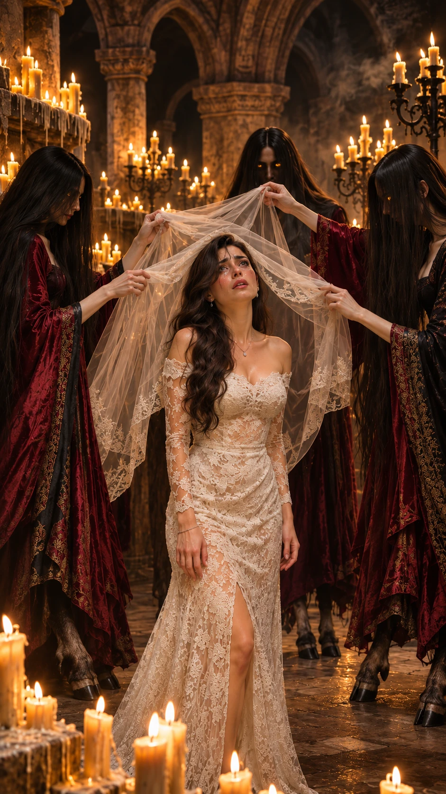

**پرامپت ویدیو (Gemini):**

```
Animate this exact image. Keep Nafiseh's face, long wavy dark-brown hair, white lace dress, the three tall women in dark-red and black robes with very long black hair and hooves, the translucent white bridal tulle veil, the candles and the ancient stone hall exactly the same. Vertical 9:16, 5 seconds, realistic live-action footage, cinematic, natural motion, no morphing.

Action: The women slowly lower the translucent white tulle veil over Nafiseh's head, the tulle drifting down in a soft slow wave; the women move in a slow, almost ritual circle around her, their long black hair and heavy velvet robes swaying, their hooves stepping slowly on the wet stone with soft clicks. Nafiseh stands almost frozen, breathing shakily, eyes full of tears and fear, lips trembling, a tear rolling down her cheek, her gaze moving slowly upward and around. The candle flames flicker and sway, wax drips slowly, thin smoke and dust drift through the air.

Camera: slow smooth push-in on Nafiseh's face with a very slight orbiting move, shallow depth of field, the foreground candles softly out of focus.

Lighting: candlelight only, warm orange glow on her face and the veil, deep dark shadows, flickering naturally.

Style: mysterious ritual ceremony, dreamlike, realistic cinematic thriller.

Sound: diegetic only — the soft crackle of candle flames, the rustle of velvet robes and tulle, slow soft hoof clicks on stone, very faint far-off indistinct whispering echoing in the hall, Nafiseh's shaky quiet breathing.
No dialogue, no voice-over. NO background music, no score, no soundtrack, no singing.
```

<div dir="rtl">

### شات ۶: سیاهی مچ نفیسه عروس رو می‌گیره

⏱ حدود ۳ ثانیه

«سیاهی» از پله‌های تالار پایین اومده و دست دودیش رو دور مچ نفیسه حلقه کرده. نفیسه با تور سفید، گریان و لرزون به بالا بهش نگاه می‌کنه. زن‌های سُم‌دار پشتش با سر خم‌شده ساکت ایستادن.


🔊 سکوت سنگین تالار، جلز و ولز شمع‌ها که با عبور سیاهی کم‌نور می‌شن، هوهوی دود، نفس‌های لرزون و بریده‌ی نفیسه، هق‌هق آروم. بدون موسیقی.

</div>

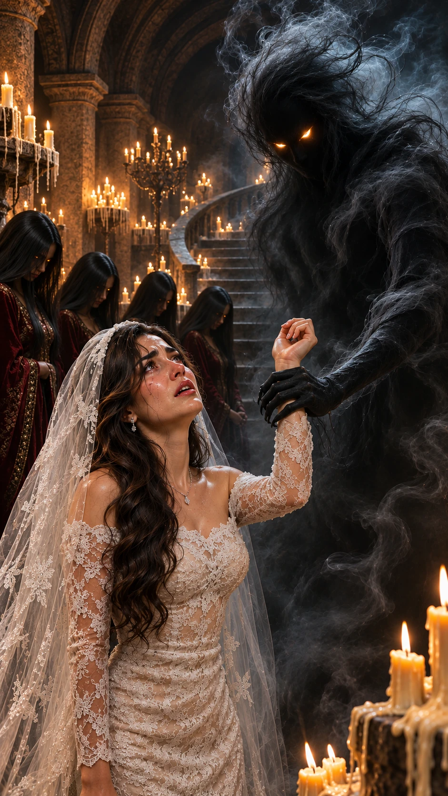

**پرامپت ویدیو (Gemini):**

```
Animate this exact image. Keep Nafiseh's face, tears, long wavy dark-brown hair, white lace dress and long lace-trimmed bridal tulle veil, the dark smoky tall figure with glowing amber eyes and its smoky hand wrapped around her wrist, the hooved women with bowed heads in the background, the curved stone staircase and the candles exactly the same. Vertical 9:16, 5 seconds, realistic live-action footage, cinematic, natural motion, no morphing.

Action: The dark smoky figure tightens its long thin fingers around Nafiseh's wrist and slowly leans its head down toward her; its smoke billows and ripples and coils around her arm and her veil, its two amber eyes glow brighter. Nafiseh trembles, breathing shakily, tears rolling down her cheeks, her lips quivering as she looks up at it; her veil and long hair sway in the drifting smoke. Candle flames bend toward the figure and dim as the smoke passes over them, then flicker back. The hooved women stand motionless with bowed heads in the background.

Camera: slow push-in toward Nafiseh's face and the wrist, slight handheld drift, shallow depth of field, foreground candles softly out of focus.

Lighting: candlelight only, warm orange on Nafiseh and the veil, the black smoke absorbing the light, cold blue rim edges on the haze, deep shadows.

Style: mysterious supernatural ceremony, realistic cinematic thriller.

Sound: diegetic only — the soft crackle of candles, a low airy hum of moving smoke, Nafiseh's shaky breaths and quiet sobbing, faint rustle of tulle.
No dialogue, no voice-over. NO background music, no score, no soundtrack, no singing.
```

<div dir="rtl">

### شات ۷: سیاهی دقیقاً پشت نفیسه، «حالا اون داماد ولم نمی‌کنه»

⏱ حدود ۳ تا ۴ ثانیه، بعدش کارت «عروسی جن‌ها | فصل دوم»

حالا. اتاق نفیسه، شب، با منظره‌ی تهران و برج میلاد. نفیسه جلوی پنجره ایستاده و فقط حس می‌کنه. «سیاهی» پشتش ایستاده و دست دودیش روی شونه‌ی اونه. توی شیشه‌ی پنجره هم بازتاب چشم‌های براقش دیده می‌شه.


**🎙 راوی:** حالا… اون داماد ولم نمی‌کنه.


🔊 یه نفس سنگین و بم مردونه کنار گوش نفیسه (از جنس «سیاهی»)، هق‌هق خیلی آروم، هوهوی دود، سکوت اتاق. بدون موسیقی.

</div>

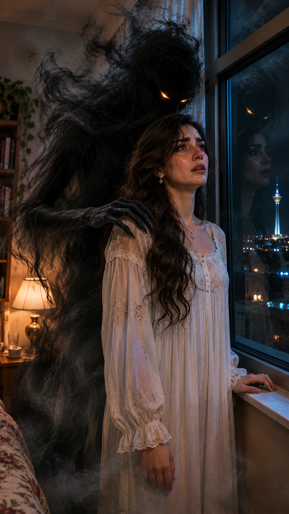

**پرامپت ویدیو (Gemini):**

```
Animate this exact image. Keep Nafiseh's face, tears, long wavy dark-brown hair, white lace nightgown, the huge black smoky figure with glowing amber eyes standing directly behind her with its smoky hand on her shoulder, the window with the Milad Tower and the faint reflections, and the room exactly the same. Vertical 9:16, 4 seconds, realistic live-action footage, cinematic, natural motion, no morphing.

Action: Nafiseh stands frozen at the window, breathing shakily, tears rolling down her cheeks, her lips trembling in a silent whisper; she does not turn around. Behind her the huge dark smoky figure slowly leans its head closer to her ear, its black haze billowing and coiling around her shoulders, its long smoky hand gently tightening on her shoulder; its amber eyes glow brighter and a faint cold fog of breath drifts past her cheek, making a few strands of her hair lift. The smoke at her feet creeps slowly across the floor. The lamp flickers once.

Camera: very slow push-in toward Nafiseh's face with the dark figure looming behind her, subtle handheld drift, shallow depth of field.

Lighting: low-key night, cold blue city glow through the window, a dim warm amber lamp, the black smoke absorbing light.

Style: mysterious supernatural thriller, realistic.

Sound: diegetic only — one long, slow, heavy deep male breath close to her ear, Nafiseh's trembling quiet sobbing, a low airy hum of moving smoke, faint lamp flicker.
No dialogue, no voice-over. NO background music, no score, no soundtrack, no singing.
```


---

<div dir="rtl">

## سکانس ۲: «یه هفته قبل» (کارت قرمز خونی روی صفحه‌ی سیاه، قبل از شات ۱)

</div>

<div dir="rtl">

### شات ۱: حموم، نفیسه حنا رو می‌ساید

⏱ حدود ۴ تا ۵ ثانیه

حموم، نور سرد. نفیسه با موی خیس، با برس کف دست‌هاش رو می‌ساید. پوستش قرمز شده، ولی حنا ذره‌ای کم‌رنگ نمی‌شه. وسط این، مادر محکم به در می‌کوبه.


**نفیسه (با خودش، گریان و عصبی):** «چرا این حنای لعنتی نمیره؟!»


**مادر (پشت در، عصبانی و بلند):** «نفیسه! یه ساعته اون تویی!»


🔊 صدای آب شیر، خش‌خش برس روی پوست، نفس‌های تند نفیسه و جمله‌ی گریان خودش، بعد ضربه‌های محکم به در و صدای مادر. بدون موسیقی.

</div>

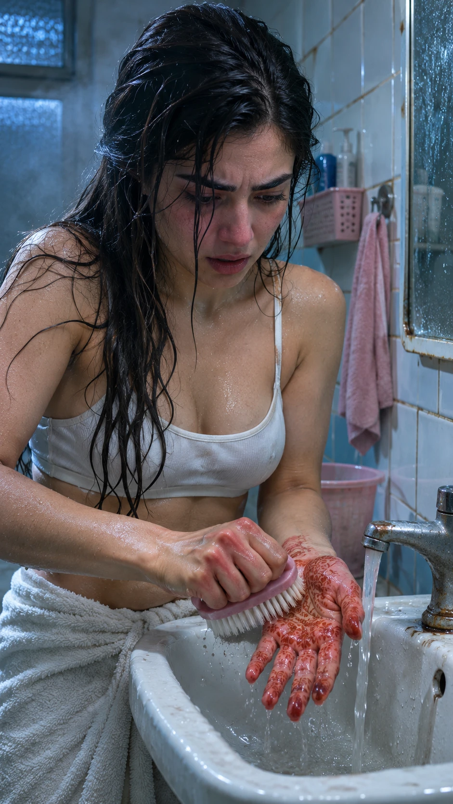

**پرامپت ویدیو (Gemini):**

```
Animate this exact image. Keep Nafiseh's face, wet dark hair, white bralette top, white towel, the pink scrub brush, the raw red hands with the stubborn henna pattern, the sink with the running tap and the whole old tiled bathroom exactly the same. Vertical 9:16, 4 seconds, realistic live-action footage, cinematic, natural motion, no morphing.

Action: Nafiseh scrubs her right palm hard and fast with the stiff brush under the running water, her shoulders trembling with effort and breathing hard, a few tears and water drops rolling down her cheeks; she suddenly stops and stares at her palm in panic — the henna pattern is still deep red and has not faded at all — and she whispers through her tears in frustration and fear. Water streams from her hand into the sink; steam drifts in the air. Then three loud hard knocks on the bathroom door make her flinch and snap her head toward the door.

Camera: handheld close medium shot, slight shake, a quick push-in on her hand and then a small pan to her startled face.

Lighting: cold blue-white bathroom light, damp reflective surfaces.

Style: tense, realistic, mysterious thriller.

Dialogue:
- Nafiseh (on screen, a young woman's voice, low, trembling and breaking, crying and furious at herself, almost a whisper, in natural Persian/Farsi): «چرا این حنای لعنتی نمیره؟!»
- Then, off-screen from behind the door, in natural Persian/Farsi, an angry middle-aged mother's voice, loud and sharp, muffled slightly by the door): «نفیسه! یه ساعته اون تویی!»

Sound: running tap water, Nafiseh's line above, the scratchy sound of the brush on skin, Nafiseh's fast shaky breaths, three hard knocks on a wooden door, then the mother's muffled shout.
NO background music, no score, no soundtrack, no singing.
```

<div dir="rtl">

### شات ۲: پذیرایی، مادر عصبانی و نفیسه با دست‌های حنایی

⏱ حدود ۵ تا ۶ ثانیه

چند سال از شب عروسی جن‌ها گذشته. حالا یه هفته به خواستگاریه. مادر تازه گوشی رو قطع کرده؛ همسایه‌ها هنوز از اون شب و حنای دست نفیسه حرف می‌زنن. نفیسه با موی خیس و دست‌های قرمز و حنایی از حموم اومده بیرون.


**مادر (عصبانی، اشاره با انگشت):** «همسایه زنگ زد… می‌گه هنوز اون حنا دستته!»


**نفیسه (گریان، ملتمس):** «مامان گفتم که… اونجا عروسی جن بود!»


🔊 صدای خفه‌ی بخار و آب از حموم، قطره‌های آب از موهای نفیسه روی زمین، نفس‌های لرزون. بدون موسیقی.

</div>

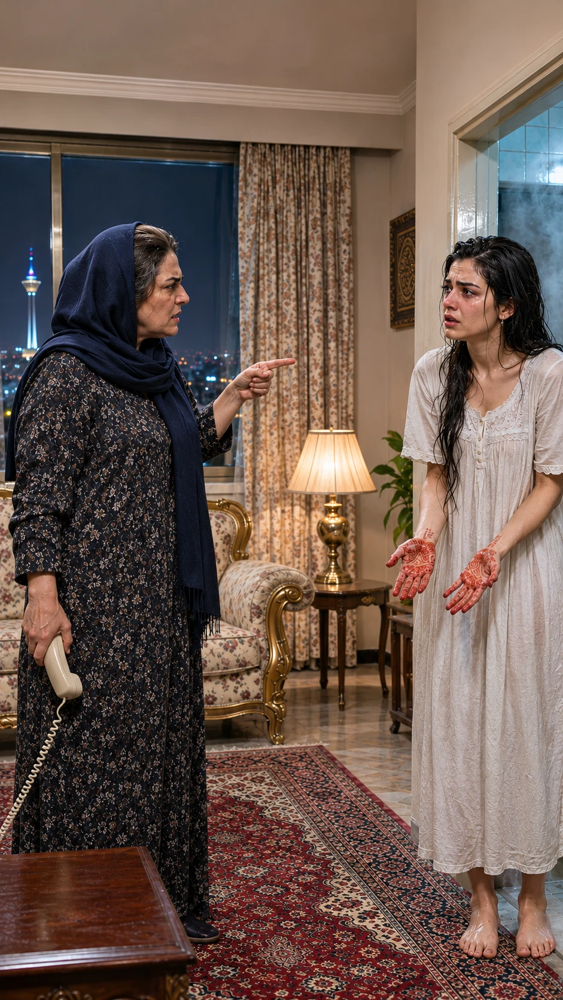

**پرامپت ویدیو (Gemini):**

```
Animate this exact image. Keep the mother's face, navy headscarf, dark floral house dress, the white landline phone in her hand with its cord, Nafiseh's face, wet dark hair, white lace-trimmed cotton house dress, her red scrubbed hands with the henna pattern, the living room with the window and the Milad Tower, the bathroom steam on the right, and the whole room exactly the same. Vertical 9:16, 6 seconds, realistic live-action footage, cinematic, natural motion, no morphing.

Action: The mother, furious and shamed, jabs her finger toward Nafiseh while scolding, her whole body leaning forward, the phone swinging in her other hand. Nafiseh, trembling and crying, steps half a step back, raises both open henna-covered palms in front of her in a pleading gesture and speaks desperately; water drips from her hair and fingers onto the floor; steam drifts out of the bathroom behind her. The mother's face flinches slightly at the word 'jinn' but stays hard.

Dialogue (spoken in natural Persian/Farsi with a Tehran accent, one after the other, emotional):
- Mother (a sharp, furious, middle-aged woman's voice, loud and bitter): «همسایه زنگ زد… می‌گه هنوز اون حنا دستته!»
- Nafiseh (a young woman's voice, trembling, crying, pleading): «مامان گفتم که… اونجا عروسی جن بود!»

Camera: handheld medium-wide shot, a slow subtle push-in toward the two faces as the argument escalates, slight shake.

Lighting: warm evening lamp light in the living room, cold blue steam light from the bathroom door.

Style: realistic family drama with a hint of mysterious thriller.

Sound: the dialogue above, Nafiseh's shaky breaths and sobs, water drips on the floor, a faint far-off city hum from the window.
NO background music, no score, no soundtrack, no singing.
```

<div dir="rtl">

### شات ۳: «بسه جن و پری!»، «با این دستا؟!»

⏱ حدود ۶ ثانیه

مادر دیگه حرف جن و پری رو نمی‌شنوه و خواستگار پنجشنبه رو بهونه می‌کنه. نفیسه گریان کف دست‌های حنایی و خیسش رو جلوی صورت مادرش می‌گیره.


**مادر (سرد و عصبانی):** «بسه جن و پری! پنجشنبه خواستگار میاد. شوهرت می‌دم، دهن مردم بسته شه.»


**نفیسه (گریان، با دست‌های بالا):** «با این دستا؟!»


🔊 نفس‌های لرزون و هق‌هق نفیسه، قطره‌های آب از دست‌ها روی زمین، سکوت سنگین بعد از جمله‌ی مادر. بدون موسیقی.

</div>

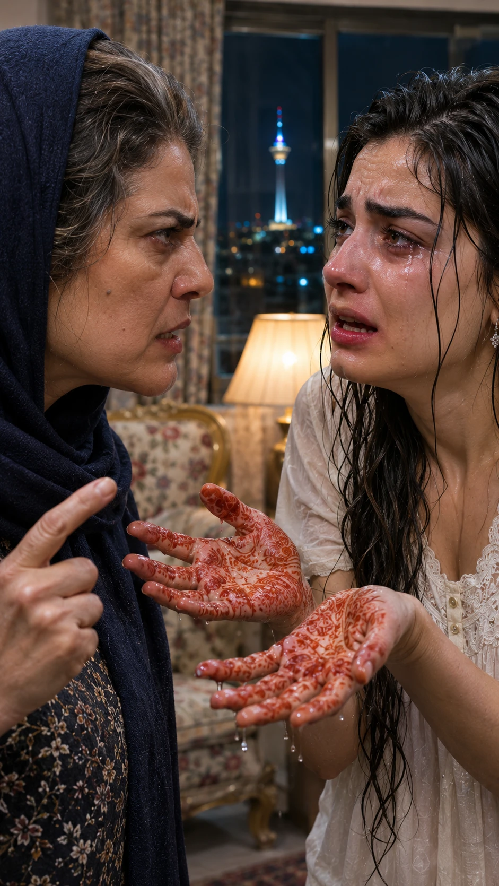

**پرامپت ویدیو (Gemini):**

```
Animate this exact image. Keep the mother's face, navy headscarf and floral dress, Nafiseh's face, wet dark hair, white lace-trimmed house dress, her red henna-covered open palms with dripping water, and the living room with the lamp, sofa and the window with the Milad Tower exactly the same. Vertical 9:16, 6 seconds, realistic live-action footage, cinematic, natural motion, no morphing.

Action: The mother, tight-jawed and furious, speaks hard and fast with a cold stare, her raised index finger jabbing at the air; her eyes briefly flicker down to the henna palms and away again. Nafiseh, crying, pushes her open henna palms closer to her mother's face and speaks with a broken voice; tears roll down her cheeks, water drips from her fingers. The mother stays stone-cold and does not soften. Both breathe heavily in the tense silence at the end.

Dialogue (spoken in natural Persian/Farsi with a Tehran accent, one after the other, emotional):
- Mother (a cold, sharp, furious middle-aged woman's voice, firm and bitter): «بسه جن و پری! پنجشنبه خواستگار میاد. شوهرت می‌دم، دهن مردم بسته شه.»
- Nafiseh (a young woman's voice, broken, trembling, crying): «با این دستا؟!»

Camera: handheld tight medium two-shot, a very slow push-in toward the henna palms and then a small rack focus to Nafiseh's face, slight shake.

Lighting: soft warm lamp light on the mother's side, cold bluish steam light on Nafiseh's side.

Style: realistic family drama with a hint of mysterious thriller.

Sound: the dialogue above, Nafiseh's shaky breaths and sobs, water dripping on the floor, a faint far-off city hum from the window.
NO background music, no score, no soundtrack, no singing.
```

<div dir="rtl">

### شات ۴: مادر دست‌های نفیسه رو پایین می‌کشه

⏱ حدود ۳ تا ۴ ثانیه

مادر دست‌های حنایی نفیسه رو با خشونت پایین می‌کشه. حالا دیگه داد نمی‌زنه؛ آروم و سرد حرف می‌زنه، چون فقط نگران آبروشه. نفیسه ساکته، شکسته و گریان.


**مادر (آروم، سرد و قاطع):** «می‌گیم واسه عروسی دخترخاله‌ت بستی. کسی نباید بفهمه.»


🔊 خش‌خش لباس و پوست، قطره‌های آب از دست‌ها روی زمین، نفس‌های لرزون نفیسه، سکوت سنگین. بدون موسیقی.

</div>

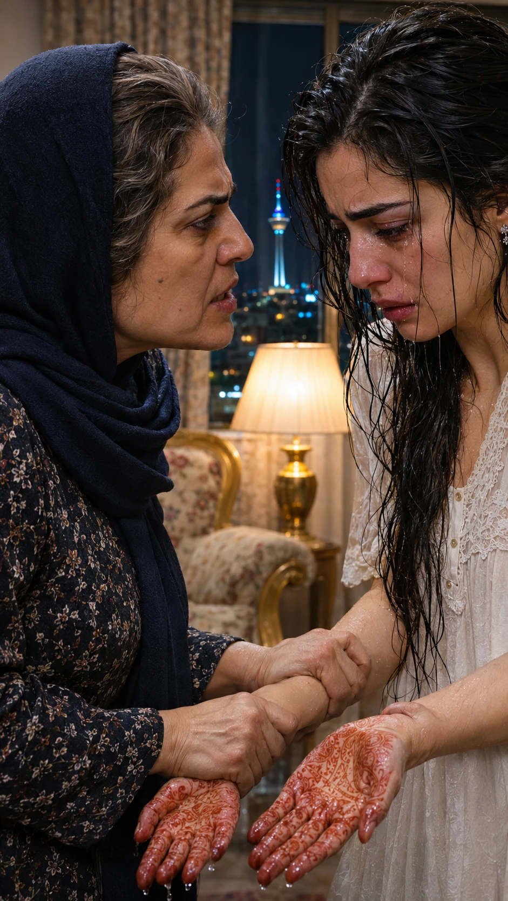

**پرامپت ویدیو (Gemini):**

```
Animate this exact image. Keep the mother's face, navy headscarf and floral dress, Nafiseh's face, wet dark hair, white lace-trimmed house dress, the mother's hands gripping Nafiseh's wrists, the red henna-covered hands dripping water, and the living room with the lamp, sofa and the window with the Milad Tower exactly the same. Vertical 9:16, 5 seconds, realistic live-action footage, cinematic, natural motion, no morphing.

Action: The mother tightens her grip on Nafiseh's wrists and pushes her hands lower, leaning in close, and speaks in a low, cold, controlled tone, her eyes fixed and hard; Nafiseh, tears rolling down her cheeks, lowers her head further and stares at her own hands, her shoulders trembling, lips pressed together, completely silent and defeated. Water drips from her fingers onto the floor.

Dialogue (spoken in natural Persian/Farsi with a Tehran accent, low, slow and flat, like a cold order):
- Mother (a quiet, cold, firm middle-aged woman's voice, almost a whisper, controlled and chilling): «می‌گیم واسه عروسی دخترخاله‌ت بستی. کسی نباید بفهمه.»
- Nafiseh stays silent.

Camera: very slow push-in toward the two faces, a slight handheld drift, shallow depth of field.

Lighting: soft warm lamp light on the mother, a cold bluish tint on Nafiseh.

Style: realistic family drama with a hint of mysterious thriller.

Sound: the dialogue above spoken softly, Nafiseh's shaky breaths and quiet sobs, water dripping on the floor, a faint far-off city hum.
NO background music, no score, no soundtrack, no singing.
```

<div dir="rtl">

### شات ۵: تماس تصویری با سارا (صفحه‌ی دو نیمه)

⏱ حدود ۴ ثانیه

شب. نفیسه توی اتاقش با سارا تماس تصویری داره. سارا نگرانه و می‌خواد نفیسه همه‌چی رو به مادرش بگه. نفیسه، شکسته و گریان، با یه پوزخند تلخ فقط حقیقت رو می‌گه که کسی باور نمی‌کنه. چراغ خواب یه لحظه چشمک می‌زنه.


**سارا (نگران):** «نفیسه، به مامانت بگو چی شده!»


**نفیسه (پوزخند تلخ و گریان):** «بگم چی؟… بگم شوهرم جنه؟»


🔊 صدای کیفیت گوشی و تماس تصویری، هق‌هق آروم نفیسه، یه لحظه جلز و ولز و خاموش‌روشن شدن چراغ خواب. بدون موسیقی.

</div>

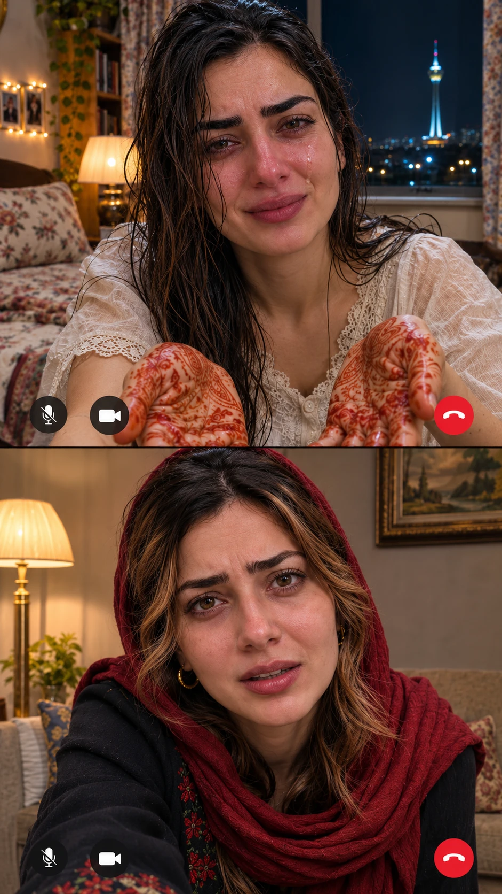

**پرامپت ویدیو (Gemini):**

```
Animate this exact image as a live smartphone video call. Keep the split-screen layout, the call buttons, Nafiseh (top frame: wet dark hair, white lace-trimmed house dress, tears, henna-covered palms, bedroom with lamp and the window with the Milad Tower) and Sara (bottom frame: deep-red scarf, balayage hair, black embroidered tunic, warm living room) exactly the same. Vertical 9:16, 5 seconds, realistic live-action footage, natural handheld phone feel, no morphing.

Action: Sara (bottom) leans toward her phone, anxious, and speaks urgently with pleading eyes. Nafiseh (top) listens with swollen red eyes, then lets out a bitter, broken half-laugh through her tears, shakes her head slowly, and answers with a trembling voice while tears roll down. At the very end, the bedside lamp behind Nafiseh flickers off and on once, and Nafiseh's eyes shift slightly toward the window behind her.

Dialogue (spoken in natural Persian/Farsi with a Tehran accent, one after the other, emotional):
- Sara (a warm, worried young woman's voice, urgent): «نفیسه، به مامانت بگو چی شده!»
- Nafiseh (a young woman's voice, broken, a bitter half-laugh mixed with crying): «بگم چی؟… بگم شوهرم جنه؟»

Camera: the two frames are slightly handheld, like real phone cameras, small natural shakes, sharp faces.

Lighting: top frame dim amber lamp and cold blue window light, bottom frame warm soft lamp light; the lamp in the top frame flickers once at the end.

Style: realistic video-call, a hint of mysterious thriller.

Sound: the dialogue above with slight phone-speaker compression, Nafiseh's sobbing, a faint electric flicker of the lamp, a very faint low hum at the end.
NO background music, no score, no soundtrack, no singing.
```


---

<div dir="rtl">

## سکانس ۳: «پنجشنبه شب» (کارت قرمز خونی روی صفحه‌ی سیاه، قبل از شات ۱)

</div>

<div dir="rtl">

### شات ۱: مادر نفیسه رو جلوی آینه مرتب می‌کنه

⏱ حدود ۳ ثانیه

پنجشنبه شب. پذیرایی آماده‌ست: سماور، میوه، شیرینی و گلدون. مادر آستین‌های بلند توری رو محکم روی دست‌های حنایی نفیسه پایین می‌کشه و زیر لب بهش هشدار می‌ده. نفیسه با لبخند اجباری و چشم‌های غمگین به آینه نگاه می‌کنه.


**مادر (زیر لب، تند و قاطع):** «دستاتو زیاد نشون نده.»


🔊 قل‌قل آروم سماور، جرینگ ملایم استکان‌ها از بیرون کادر، خش‌خش لباس توری و تور، نفس‌های آروم نفیسه. بدون موسیقی.

</div>

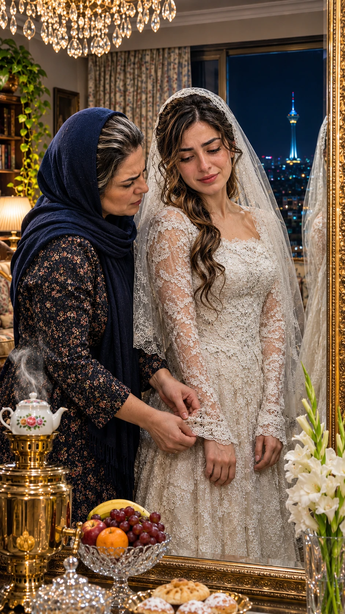

**پرامپت ویدیو (Gemini):**

```
Animate this exact image. Keep Nafiseh's face, long wavy dark-brown hair, sheer veil and white lace dress, her mother's face, navy headscarf and floral dress, the large gold-framed mirror with their reflections, the steaming brass samovar, the fruit bowl, the gladiolus vase, the chandelier and the window with the Milad Tower exactly the same. Vertical 9:16, 4 seconds, realistic live-action footage, cinematic, natural motion, no morphing.

Action: The mother, stern and tense, tugs the long lace cuffs down hard over Nafiseh's hands to hide the henna, leans in close to her ear and whispers a sharp warning without looking away from the sleeve; Nafiseh keeps her eyes lowered, takes a shaky breath, forces a small sad smile, and slowly lifts her eyes to meet her own reflection in the mirror. Steam drifts from the samovar, the chandelier crystals twinkle.

Dialogue (spoken in natural Persian/Farsi with a Tehran accent, whispered, quick and sharp):
- Mother (a low, tense, firm middle-aged woman's whisper): «دستاتو زیاد نشون نده.»
- Nafiseh stays silent.

Camera: slow push-in toward the two faces, a slight handheld drift, shallow depth of field.

Lighting: warm evening tungsten light, soft shadows.

Style: realistic family drama with a hint of mysterious thriller.

Sound: the whispered line above, the soft bubbling of the samovar, the rustle of lace and tulle, faint clinking of glasses from off-screen, Nafiseh's slow breathing.
NO background music, no score, no soundtrack, no singing.
```

<div dir="rtl">

### شات ۲: خانواده‌ی داماد و مادر نفیسه، گپ و خنده

⏱ حدود ۴ ثانیه

خانواده‌ی داماد روی مبل نشستن و همه با هم می‌خندن؛ فضا گرم و دوستانه به نظر می‌رسه، آرامش قبل از طوفان. مادر داماد با خنده یه سؤال می‌پرسه و مادر نفیسه با خنده‌ی عصبی سریع جواب می‌ده.


**مادر داماد (با خنده، کنجکاو):** «شنیدیم عروس خانوم یه زمانی دف می‌زده؟»


**مادر نفیسه (با خنده‌ی عصبی، سریع):** «نه بابا… یه وقتی، فقط تو مجلسای خانوادگی.»


🔊 خنده‌ی آروم و دوستانه‌ی همه، قل‌قل سماور، جرینگ ملایم استکان و ظرف شیرینی. بدون موسیقی.

</div>

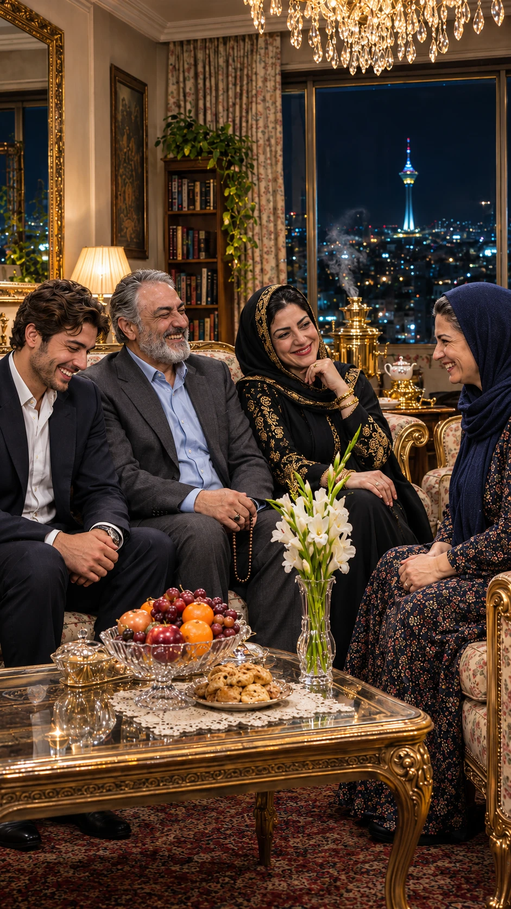

**پرامپت ویدیو (Gemini):**

```
Animate this exact image. Keep the faces, clothes and seating of all four people exactly the same: the groom (left, dark suit, white shirt), the groom's father (grey suit, tasbih), the groom's mother (black gold-embroidered manteau and scarf, gold bangles) and Nafiseh's mother (navy headscarf, floral dress, opposite them), plus the glass coffee table with the fruit bowl, pastries and gladiolus, the steaming samovar, the chandelier and the window with the Milad Tower. Vertical 9:16, 5 seconds, realistic live-action footage, cinematic, natural motion, no morphing.

Action: a warm, cheerful family chat. Everyone is smiling and laughing naturally. The groom's mother, laughing and leaning a little forward with her chin resting on her hand, asks a curious question with a bright smile; Nafiseh's mother answers quickly with a nervous, slightly too-wide laugh, waving her hand lightly; the groom laughs softly and looks down shyly; the groom's father chuckles and nods, turning his tasbih beads. A thin wisp of steam rises from the samovar.

Dialogue (spoken in natural Persian/Farsi with a Tehran accent, light and friendly, with laughter):
- Groom's mother (a polished, cheerful middle-aged woman's voice, laughing): «شنیدیم عروس خانوم یه زمانی دف می‌زده؟»
- Nafiseh's mother (a nervous, quick middle-aged woman's voice, with a forced laugh): «نه بابا… یه وقتی، فقط تو مجلسای خانوادگی.»

Camera: slow gentle push-in on the group, subtle handheld drift, shallow depth of field.

Lighting: warm evening tungsten light, the chandelier glowing.

Style: warm, realistic family gathering, calm before the storm.

Sound: the dialogue above, soft friendly laughter from everyone, the quiet bubbling of the samovar, a faint clink of a glass.
NO background music, no score, no soundtrack, no singing.
```

<div dir="rtl">

### شات ۳: لبخند داماد و اولین لبخند نفیسه

⏱ حدود ۳ ثانیه، بعدش سکوت ناگهانی

نفیسه با سینی چای وارد می‌شه. داماد با نگاه گرم و کمی خجالتی بهش لبخند می‌زنه و نفیسه برای اولین بار یه لبخند کوچیک و واقعی می‌زنه. یه لحظه‌ی نادر از آرامش و امید، درست قبل از اینکه همه‌چی خراب بشه.


🔊 آروم و گرم: قل‌قل ملایم سماور، جرینگ استکان‌ها روی سینی. در انتهای شات یهو همه‌ی صداها قطع می‌شه و سکوت میاد (موسیقی رو خودت توی ادیت می‌ذاری و اینجا قطعش می‌کنی). بدون موسیقی.

</div>

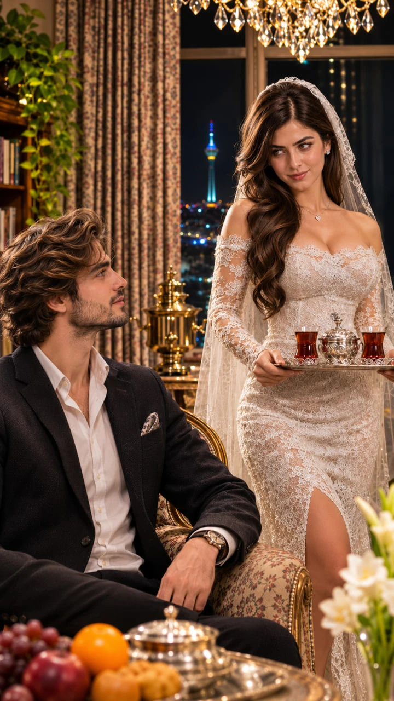

**پرامپت ویدیو (Gemini):**

```
Animate this exact image. Keep the groom's face, wavy brown hair, dark suit and white shirt, Nafiseh's face, long wavy dark-brown hair, white off-shoulder lace dress, the sheer veil, the silver tray with tea glasses, the samovar, the fruit and gladiolus, the chandelier and the window with the Milad Tower exactly the same. Vertical 9:16, 4 seconds, realistic live-action footage, cinematic, natural motion, no morphing.

Action: Nafiseh walks slowly and gracefully toward the sofa carrying the tray with both hands, the tea glasses trembling slightly; she glances up and meets the groom's eyes. The groom, seated, turns his head toward her and gives a soft, warm, shy smile; Nafiseh's face softens and a small, genuine, hopeful smile appears on her lips for the first time, her eyes shining. They hold each other's gaze for a beat. A thin wisp of steam rises from the samovar and the veil gently sways.

Camera: slow, smooth push-in toward the two faces, shallow depth of field, a slight handheld drift.

Lighting: warm, golden evening light, the chandelier glowing.

Style: tender, romantic, realistic, the calm before the storm.

Sound: diegetic only — the soft bubbling of the samovar, a gentle clink of tea glasses on the silver tray, quiet footsteps and the rustle of lace and tulle; at the very last half second every sound drops out into sudden silence.
No dialogue. NO background music, no score, no soundtrack, no singing.
```

<div dir="rtl">

### شات ۴: چراغ‌ها چشمک می‌زنن و سیاهی پشت داماد توی شیشه

⏱ حدود ۳ ثانیه

وسط لبخند داماد، چراغ‌ها چشمک می‌زنن و قل‌قل سماور می‌خوابه. نفیسه به شیشه‌ی پنجره نگاه می‌کنه: دقیقاً پشت سر داماد، «سیاهی» با دو چشم براق ایستاده. فقط نفیسه می‌بینه و لبخندش خشک می‌شه.


🔊 قل‌قل سماور یه‌دفعه می‌خوابه، جلز و ولز و وز وز لوستر که چشمک می‌زنه، سکوت سنگین، نفس بریده‌ی نفیسه. بدون موسیقی.

</div>

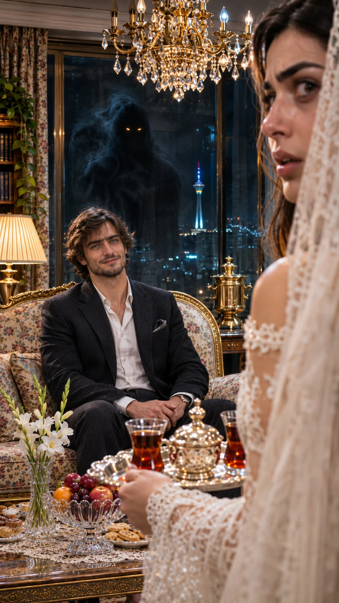

**پرامپت ویدیو (Gemini):**

```
Animate this exact image. Keep the over-the-shoulder foreground of Nafiseh (lace veil, her face at the right edge), the groom seated on the sofa with a soft smile, the silver tray with tea glasses, the fruit and flowers, the lamp, the samovar, and the dark window with the smoky black figure with glowing amber eyes behind the groom exactly the same. Vertical 9:16, 4 seconds, realistic live-action footage, cinematic, natural motion, no morphing.

Action: The chandelier above begins to flicker, its warm light dipping and flashing, a cold blue tint spreading across the room; the steam from the samovar stops. The groom keeps smiling warmly, completely unaware. In the dark window behind his head the huge smoky figure slowly rises and moves a little closer to the glass, its black haze coiling, its two amber eyes glowing brighter and fixed on Nafiseh. Nafiseh's smile freezes and drops, her eyes widen in fear, her lips part and her breath catches; the tea glasses on the tray tremble.

Camera: very slow push-in over Nafiseh's shoulder toward the groom and the window, a subtle handheld drift, focus gently shifting from the groom to the figure in the window.

Lighting: warm light collapsing into cold blue shadows as the chandelier flickers, the amber eyes the brightest point.

Style: mysterious supernatural thriller, realistic.

Sound: diegetic only — the bubbling of the samovar suddenly stops, the electric buzz and flicker of the chandelier, tea glasses rattling faintly on the tray, a sharp catch of breath from Nafiseh, then heavy silence.
No dialogue. NO background music, no score, no soundtrack, no singing.
```

<div dir="rtl">

### شات ۵: همون صحنه‌ی قلاب از زاویه‌ی دیگه (دست سیاه، سینی کج، چای می‌پره)

⏱ حدود ۳ ثانیه

همون لحظه‌ی قلاب، این بار از سمت مهمون‌ها: دست دودی سیاه مچ نفیسه رو می‌گیره، سینی کج می‌شه و چای جوش به سمت مادر داماد می‌پره. داماد با وحشت سرش رو برمی‌گردونه. ادیت: بعدش برش به تصاویر قلاب (s1_shot2 و s1_shot3) برای جیغ و شکستن استکان‌ها.


**مادر داماد:** «(جیغ بلند از درد، بدون کلمه)»


🔊 جرینگ و لرزیدن استکان‌ها، شُرّه‌ی چای، نفس تند نفیسه، بعد جیغ مادر داماد و شکستن شیشه. بدون موسیقی.

</div>

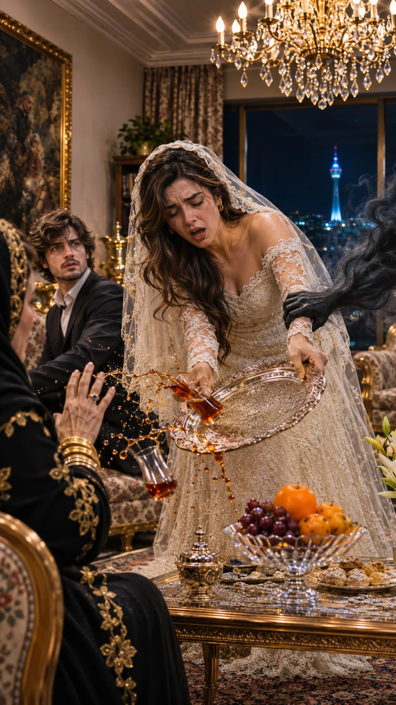

**پرامپت ویدیو (Gemini):**

```
Animate this exact image. Keep Nafiseh's face, veil and white lace dress, the black smoky hand gripping her wrist, the silver tray, the groom's startled face, the groom's mother in the black embroidered outfit in the foreground, the fruit bowl, the chandelier and the window with the Milad Tower exactly the same. Vertical 9:16, 4 seconds, realistic live-action footage, cinematic, natural physics, no morphing.

Action: The black smoky hand yanks Nafiseh's wrist and the silver tray tips fully; the tea glasses slide, fall and splash hot amber tea across the groom's mother's hand and lap in glossy arcs, steam rising. The groom's mother recoils and screams in pain; the groom jerks his head and half rises, shocked; Nafiseh gasps, eyes wide with horror, trying to pull her arm back as dark wisps of smoke coil off the hand. One glass shatters on the glass coffee table's edge and shards bounce on the carpet.

Camera: handheld wide shot with a sharp jolt at the moment of impact, a quick small push-in toward Nafiseh's terrified face.

Lighting: warm tungsten light, a cold shadow around the black hand.

Style: sudden, chaotic, realistic mysterious thriller.

Sound: diegetic only — rattling and sliding glasses, the splash of tea, a loud pained scream from the groom's mother (no words), shattering glass, Nafiseh's sharp gasp.
NO background music, no score, no soundtrack, no singing.
```

<div dir="rtl">

### شات ۶ (جدید): مادر داماد عصبانی می‌شه: «دختر شما دیوونه‌ست!»

⏱ حدود ۴ ثانیه

بعد از حادثه‌ی چای. مادر داماد با لباس خیس و دست قرمز، عصبانی به نفیسه اشاره می‌کنه و فریاد می‌زنه. پدر داماد بازوش رو گرفته و به سمت در می‌بردش، داماد ناراحت و مردد پشتشونه. نفیسه با سر پایین و اشک ایستاده و مادرش دو دست روی سرش گذاشته.


**مادر داماد (فریاد، عصبانی و تحقیرشده):** «دختر شما دیوونه‌ست! من همچین عروسی نمی‌خوام!»


**مادر نفیسه (التماس‌کنان):** «نه خانوم… خواهش می‌کنم…»


🔊 فریاد مادر داماد، هق‌هق نفیسه، التماس مادرش، قطره‌های چای و ریزش شیشه‌ریزه‌ها روی فرش، قدم‌های تند. بدون موسیقی.

</div>

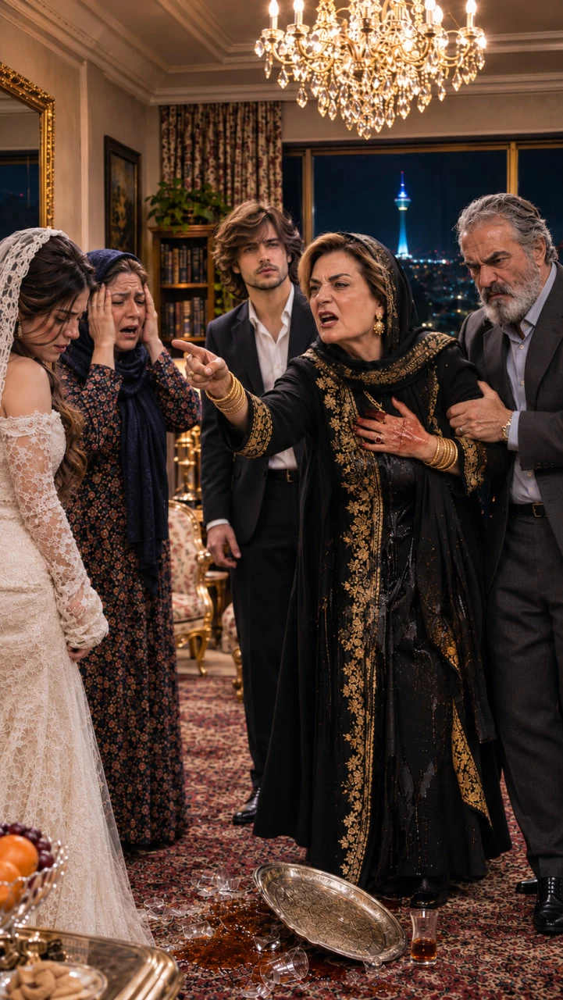

**پرامپت ویدیو (Gemini):**

```
Animate this exact image. Keep every face, outfit and position exactly the same: Nafiseh in the white lace dress and veil on the left, her mother with both hands on her head, the groom in the dark suit, the groom's mother in the wet black gold-embroidered manteau pointing, the groom's father in the grey suit gripping her arm, the tipped silver tray, tea and glass shards on the red carpet, the chandelier and the window with the Milad Tower. Vertical 9:16, 5 seconds, realistic live-action footage, cinematic, natural motion, no morphing.

Action: The groom's mother, shaking with fury and humiliation, jabs her finger at Nafiseh and shouts, then tears her arm from the grip and turns toward the door; the groom's father, jaw clenched, pulls her along firmly by the arm. The groom hesitates, torn, glances back at Nafiseh with sad worried eyes, then follows. Nafiseh stays frozen, tears rolling down her cheeks, her head lowered; her mother takes a step toward the guests with both hands on her head, pleading.

Dialogue (spoken in natural Persian/Farsi with a Tehran accent, loud and emotional):
- Groom's mother (a loud, furious, humiliated middle-aged woman's voice, shouting): «دختر شما دیوونه‌ست! من همچین عروسی نمی‌خوام!»
- Nafiseh's mother (a trembling, pleading middle-aged woman's voice): «نه خانوم… خواهش می‌کنم…»

Camera: handheld medium-wide shot, a slow push-in at first and then a slight pan following the guests toward the door, small shakes.

Lighting: warm tungsten light, harsh and dramatic, deep shadows on the angry faces.

Style: realistic family drama with a hint of mysterious thriller.

Sound: the dialogue above, Nafiseh's quiet sobbing, quick footsteps on the carpet, a few remaining drops and glass shards clinking.
NO background music, no score, no soundtrack, no singing.
```

<div dir="rtl">

### شات ۷: خانواده‌ی داماد با قهر می‌رن، داماد دم در

⏱ حدود ۲ تا ۳ ثانیه

پدر و مادر داماد عصبانی از در بیرون می‌رن. داماد دم در می‌ایسته، یه نگاه غمگین و پشیمون به نفیسه می‌ندازه که با اشک و تور سر افتاده توی پیش‌زمینه‌ست. بعد در محکم بسته می‌شه.


🔊 قدم‌های تند روی راه‌پله، سکوت، صدای محکم بسته شدن در، سکوت سنگین بعدش. بدون موسیقی.

</div>

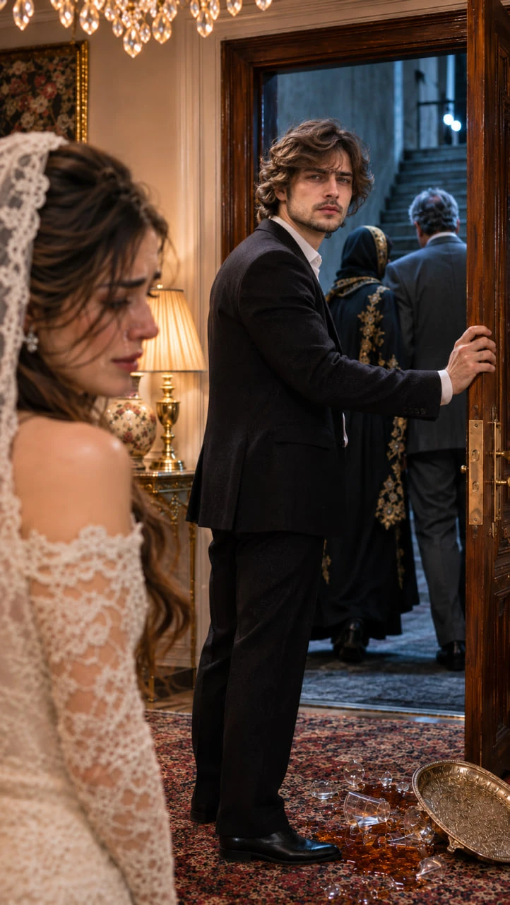

**پرامپت ویدیو (Gemini):**

```
Animate this exact image. Keep Nafiseh's face, tears, veil and white lace dress in the left foreground, the groom's face, wavy brown hair, dark suit and hand on the open wooden door, his parents (the mother in the black gold-embroidered manteau and the father in the grey suit) walking away on the stairwell landing, the spilled tea and glass shards and the silver tray on the red carpet exactly the same. Vertical 9:16, 4 seconds, realistic live-action footage, cinematic, natural motion, no morphing.

Action: The groom holds the door and looks back at Nafiseh for a long beat with a sad, hurt, regretful gaze, his jaw tight, his eyes glossy. Nafiseh, tears rolling down her cheek, slowly lifts her eyes toward him without a word. The groom lowers his eyes, steps back through the doorway and pulls the heavy wooden door shut with a firm bang. The light from the stairwell vanishes, leaving the warm room; the chandelier light trembles slightly.

Camera: slow, subtle push-in toward the groom in the doorway, then a slight rack focus to Nafiseh's tearful face as the door closes, handheld drift.

Lighting: cold blue light from the stairwell, warm tungsten light in the living room.

Style: realistic family drama, a goodbye without a word.

Sound: diegetic only — quick footsteps on the stairs, a heavy pause, the firm bang of the door closing, then heavy silence with only Nafiseh's quiet shaky breath.
No dialogue. NO background music, no score, no soundtrack, no singing.
```

<div dir="rtl">

### شات ۸: سکوت و سیلی مادر

⏱ حدود ۲ ثانیه

مهمون‌ها رفتن و خونه ساکته. مادر نفیسه، با چشم‌های اشکی و پر از خشم و شرم، سیلی محکمی به نفیسه می‌زنه. صورت نفیسه کج می‌شه، موهاش پخش می‌شه، تور از سرش می‌افته و جای دست روی گونه‌ش قرمز می‌شه.


**مادر نفیسه (شکسته، پر از خشم و اشک):** «آبرومونو بردی!»


🔊 سکوت مطلق، بعد صدای خشک سیلی، نفس بریده‌ی نفیسه، هق‌هق مادر. بدون موسیقی.

</div>

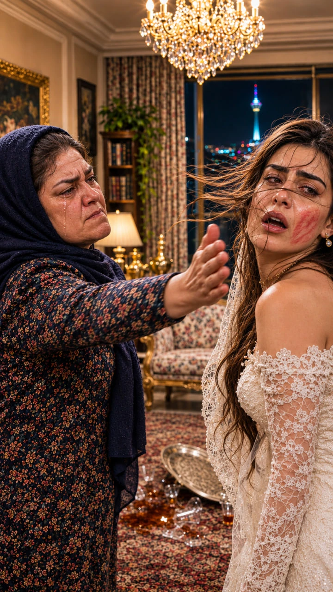

**پرامپت ویدیو (Gemini):**

```
Animate this exact image. Keep Nafiseh's face, long wavy dark-brown hair, white off-shoulder lace dress, the veil sliding off, her mother's face, navy headscarf and floral dress, the wrecked living room with the tipped silver tray, spilled tea and glass shards, the chandelier and the window with the Milad Tower exactly the same. Vertical 9:16, 3 seconds, realistic live-action footage, cinematic, natural motion, no morphing.

Action: Complete silence for a beat, both women still. The mother, tears running down her face, swings her open hand and slaps Nafiseh across the cheek with a sharp crack; Nafiseh's head whips sideways, her long hair flies across her face, the veil slides off and falls, a red handprint spreading on her cheek; she freezes, eyes wide and wet, lips trembling, slowly turning her head back toward her mother. The mother's arm falls, her face crumples with shame and anger, her lips tremble as she speaks.

Dialogue (spoken in natural Persian/Farsi with a Tehran accent, low, broken and bitter):
- Mother (a cracked, shaking, middle-aged woman's voice, full of anger and tears): «آبرومونو بردی!»
- Nafiseh stays silent.

Camera: locked-off tight medium shot with a tiny shake at the moment of the slap, then a slow push-in toward Nafiseh's face.

Lighting: warm tungsten light, harsh shadows.

Style: realistic family drama, devastating silence.

Sound: total silence for the first beat, then the sharp crack of the slap, a sharp intake of breath, soft sobbing, the mother's broken line, the quiet of the empty room.
NO background music, no score, no soundtrack, no singing.
```


---

<div dir="rtl">

## سکانس ۴: قلاب پایانی (بدون تماس تلفنی)

</div>

<div dir="rtl">

### شات ۲ و ۳: سیاهی توی شیشه‌ی پنجره: «تو زن منی…»

⏱ حدود ۵ ثانیه

نیمه‌شب. نفیسه شکسته و گریان کنار پنجره روی زمین نشسته. سرش رو برمی‌گردونه و «سیاهی» رو بزرگ و نزدیک پشت شیشه می‌بینه؛ دستش رو روی شیشه گذاشته. با صدای بم می‌گه که اون زنشه و کسی حق نداره بهش نگاه کنه. بعد دودش آروم محو می‌شه.


**سیاهی (صدای بم، سرد و پژواک‌دار، از پشت شیشه):** «تو زن منی… دیگه هیچ‌کس جز من حق نداره بهت نگاه کنه.»


🔊 صدای بم و خفه‌ی «سیاهی» از پشت شیشه با پژواک، هق‌هق بریده‌ی نفیسه، باد کم‌صدا، در پایان سکوت. بدون موسیقی.

</div>

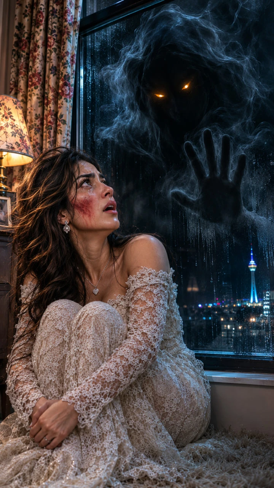

**پرامپت ویدیو (Gemini):**

```
Animate this exact image. Keep Nafiseh's face, tear-streaked cheek with the red mark, messy long dark-brown hair, white off-shoulder lace dress, the bedroom, the window with the rain-streaked glass and the Milad Tower, and the huge black smoky figure with glowing amber eyes and its hand pressed on the glass exactly the same. Vertical 9:16, 6 seconds, realistic live-action footage, cinematic, natural motion, no morphing.

Action: Nafiseh, sitting on the floor with her knees pulled up, stares up at the figure in the glass, trembling, breathing in short gasps, tears rolling down her cheek, her lips parted in fear and heartbreak. The huge smoky figure presses its palm flat against the glass, the black haze coiling and rippling, cold fog of breath spreading on the glass around its hand, its two amber eyes glowing brighter and fixed on her. As it speaks, the smoke around its head pulses in rhythm with the voice. At the end the smoke slowly fades away from the glass like dissolving into the night, leaving only the city lights and the Milad Tower, and Nafiseh frozen, staring at the empty glass.

Dialogue (spoken in natural Persian/Farsi, once, slowly, calm and possessive, with a slight echo):
- The dark figure (deep, cold, low, slightly raspy male voice with a faint echo, muffled slightly as if through glass, a calm possessive quiet threat, not shouting): «تو زن منی… دیگه هیچ‌کس جز من حق نداره بهت نگاه کنه.»

Camera: slow push-in toward Nafiseh's face then rack focus to the figure in the glass while it speaks, subtle handheld drift.

Lighting: cold blue moonlight and city glow, the amber eyes the brightest point, the warm lamp flickering once.

Style: mysterious supernatural thriller, realistic.

Sound: the figure's deep echoing voice speaking the line above; Nafiseh's shaky breaths and quiet sobs; a faint low airy hum; a faint electric flicker of the lamp; silence at the end.
NO background music, no score, no soundtrack, no singing.
```

<div dir="rtl">

### شات ۴: صبح، مادر پشت تلفن: «داماد تصادف کرده»

⏱ حدود ۳ ثانیه

صبح روز بعد. مادر توی آشپزخونه پشت تلفن، رنگش پریده و اشک می‌ریزه، دستش روی دهنشه. نفیسه با پیژامه و موی ژولیده از دم در نگاهش می‌کنه، جای قرمز سیلی هنوز روی گونه‌شه. خبر رسیده: داماد تصادف کرده.


**مادر نفیسه (توی تلفن، لرزون، با گریه):** «…پسره دیشب، تو راه برگشت… تصادف کرده.»


🔊 صدای لرزش نفس‌ها، هق‌هق خفه‌ی مادر، چرخش سیم مارپیچ تلفن، جلز و ولز کتری، سکوت سنگین بعد از جمله. بدون موسیقی.

</div>

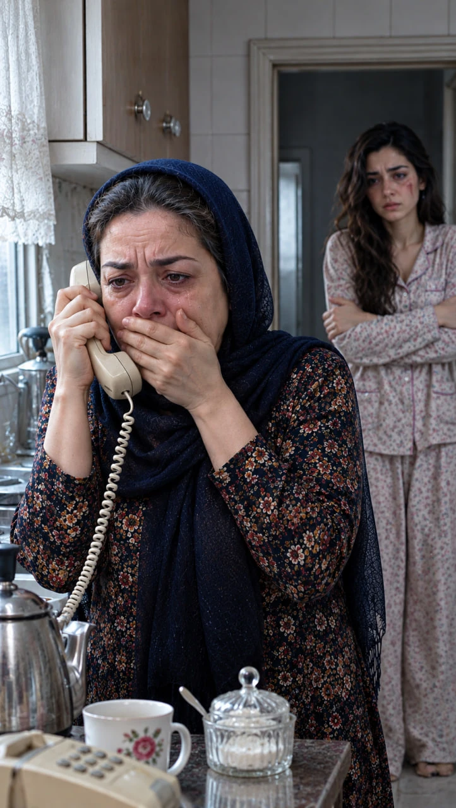

**پرامپت ویدیو (Gemini):**

```
Animate this exact image. Keep the mother's face, navy lace headscarf and floral dress, the cream landline phone with its coiled cord, her hand over her mouth, the kitchen with the kettle, cup, sugar bowl and lace curtain, and Nafiseh standing in the doorway in her floral pajamas with her arms crossed and the faded red mark on her cheek exactly the same. Vertical 9:16, 4 seconds, realistic live-action footage, cinematic, natural motion, no morphing.

Action: The mother listens to the phone, her face collapsing, tears rolling down her cheeks; she presses her trembling hand harder over her mouth, her shoulders shaking, then lowers her hand and says the line in a broken voice, her eyes going unfocused, the coiled phone cord swaying. In the doorway Nafiseh stays motionless, her face going completely numb with horror, slowly hugging her own arms tighter and her eyes widening in terrible realization; the cold morning light flickers slightly across her face.

Dialogue (spoken in natural Persian/Farsi with a Tehran accent, trembling and broken, as if on a phone call):
- Mother (a shaking, tearful, shocked middle-aged woman's voice): «…پسره دیشب، تو راه برگشت… تصادف کرده.»
- Nafiseh stays silent.

Camera: slow push-in toward the mother's face, then a subtle rack focus to Nafiseh in the doorway, slight handheld drift.

Lighting: flat cold grey morning light with a faint blue tint.

Style: realistic family drama with a hint of mysterious thriller.

Sound: the mother's broken line, quiet sobbing, her ragged breath, the creak of the coiled phone cord, the faint hiss of the kettle, a heavy silence at the end.
NO background music, no score, no soundtrack, no singing.
```

<div dir="rtl">

### شات ۵: حنای تازه دور انگشت و راوی پایانی

⏱ حدود ۴ تا ۵ ثانیه، بعدش کارت پایانی

نفیسه با چشم‌های اشکی و وحشت‌زده به کف دستش نگاه می‌کنه. یه خط حنای تازه و خیس دور انگشت حلقه‌ش ظاهر شده، مثل یه انگشتر. می‌فهمه «سیاهی» فقط عاشقش نیست؛ هر کی بهش نزدیک بشه از بین می‌بره.


**🎙 راوی:** اون شب فهمیدم… اون فقط عاشقم نیست. هر کی به من نزدیک بشه… از بین می‌بره.


🔊 نفس‌های لرزون و بریده‌ی نفیسه، یه هوهوی سرد و بم خیلی کم‌صدا، سکوت سنگین. بدون موسیقی.

</div>

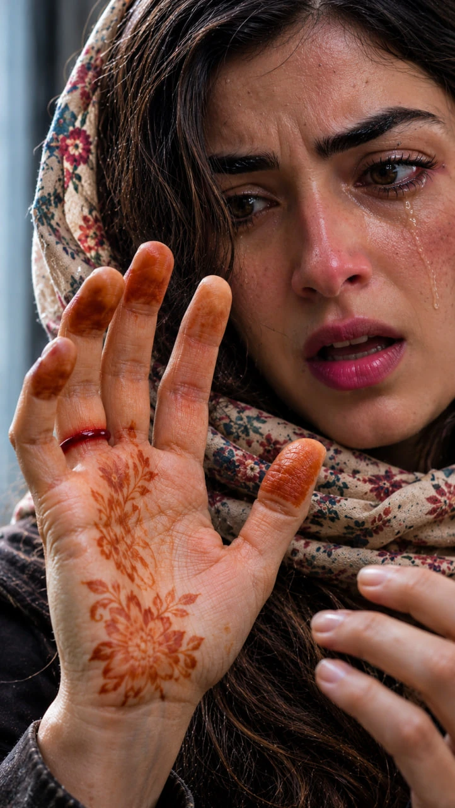

**پرامپت ویدیو (Gemini):**

```
Animate this exact image. Keep Nafiseh's face, tear-streaked cheek, messy dark-brown hair, the floral scarf around her neck, her open left palm with the faded henna pattern, the fresh glossy red ring-shaped line around the base of her ring finger, her other trembling hand at the frame edge, and the soft cold window light exactly the same. Vertical 9:16, 5 seconds, realistic live-action footage, cinematic, natural motion, no morphing.

Action: Nafiseh stares at her palm in horror, her breath shaking and her chest rising fast, tears rolling down her cheek, her lips trembling. The fresh red ring of henna around her finger glistens and seems to slowly deepen in color as if still being drawn; thin dark wisps of smoke curl faintly off her fingertips and vanish. Her other hand rises toward her mouth and trembles. She slowly curls her fingers into a fist around the mark and her eyes slowly shift off to the side, toward the window, with dawning, terrible understanding.

Camera: slow push-in from the palm to her face, then a gentle rack focus from the ring-shaped mark to her wide wet eyes, subtle handheld drift.

Lighting: cold grey-blue morning window light, a faint warm amber glow in the henna.

Style: mysterious supernatural thriller, realistic, quiet horror.

Sound: diegetic only — her shaky breaths and a muffled sob, a faint low cold airy hum, nothing else; heavy silence at the end.
No dialogue, no voice-over. NO background music, no score, no soundtrack, no singing.
```
